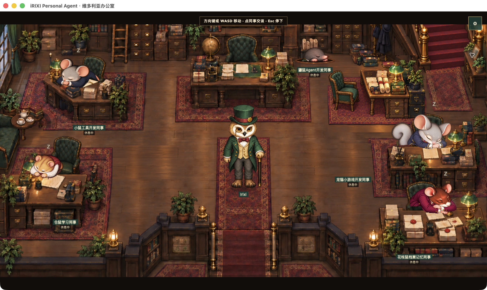

# iRIXI Personal Agent

### Talk through an idea. Build a real project. Pick it up next time.

A desktop personal AI agent for local projects, coding and learning — with persistent conversations, editable memory, real tools, and a living Victorian office.

**[简体中文](README.zh-CN.md) · [Get started](docs/getting-started.md) · [Project examples](docs/showcase.md) · [Latest release](https://github.com/Irixil/irixi-office-agent/releases/tag/preview-2026-10-31) · [Contribute](CONTRIBUTING.md)**



*Actual macOS app, October 30. Click a colleague to open a conversation. Local office animation does not call a model.*

iRIXI helps you discuss, build, modify and continue your own projects. Start with a conversation. When you ask it to begin, the agent works on real files, runs checks and delivers a usable result. Return later with the same files, conversations and project decisions.

## Why iRIXI

| Your workflow | What you get |
| --- | --- |
| Think before you build | Discuss an idea first. An explicit instruction starts file changes. |
| Work in your own folder | Multiple conversations share a project’s actual files and relevant history. |
| Build and revise real deliverables | Read and edit code, run commands, inspect results and request changes. |
| Bring context with you | Quote messages, attach materials, reference another conversation, or branch to explore another direction. Git projects can use a separate worktree. |
| Keep useful memory | Separate personal preferences, project decisions and temporary requirements. Edit, disable, restore or delete saved memory. |
| Share work across helpers | Inspect real read-only helpers and scoped writes in independent copies, then check combined results before adoption. |
| Choose your connection | Select an available model and reasoning level for the next turn. Use an existing configured CLI connection or the official OpenAI API Key route. |
| Stop and return later | Keep progress, history and outcomes. Reopening the app does not silently restart model work. |

Project menus include rename, pin, unread state, sections, archive, restore and new windows. Messages support copying, quoting, revision branches and conversation branches. The bottom conversation expands for longer work and shares its draft and history.

## Five colleagues, one workbench

A hamster for learning, a mouse for tools, a chinchilla for games, a mole for agent development, and a fancy rat for archives and memory. These are starting specialties; every colleague can handle general project work. The learning route can use a locally installed learning skill. The game route can use a separately prepared Noobi integration with a compatible connection.

The office shows real work states. Walking, idle activities, desk sleep and waking are local animations. Reduced-motion support is available.

## From conversation to a working result

```text
Discuss → Ask it to begin → Choose a folder when needed
        → Build and check → Open the result → Request a change
        → Stop, reopen, or continue in another project conversation
```

A recent local example extended an existing focus-recording web app with record editing. Through the product’s normal OmO and official OpenAI API Key route, the agent delivered add/edit/cancel/delete flows and daily totals. Refresh and native-app reopening preserved the records. Foundation fixes and external review were performed separately from the agent’s project work. [More examples →](docs/showcase.md)

There is no mandatory project setup form or fixed approval ladder for ordinary work. Questions and new permissions are handled in context.

## Run from source

**Source preview for developers.** The current native shell targets macOS. Prepare Node.js 24+, npm, Git, a desktop browser, OmO 5.1.40 and the configured Codex CLI before real agent work. Runtimes and a signed installer are not bundled.

```bash
git clone https://github.com/Irixil/irixi-office-agent.git
cd irixi-office-agent
npm ci
npm start
```

Open [localhost:58312](http://127.0.0.1:58312/?backend=openoffice&view=office). Starting the interface does not start model work. [Full setup, connection options and isolated development →](docs/getting-started.md)

## Latest source preview · October 31, 2026

- Persistent project conversations, editable memory, specialist handoff and scoped parallel helpers.
- Official OpenAI API Key file connection and updated tool/check/recovery handling.
- Refined seating, movement and desk-sleep transitions across the office.
- Source synchronized with the October 30 local deliveries, plus refreshed English and Chinese documentation.

[Release notes](https://github.com/Irixil/irixi-office-agent/releases/tag/preview-2026-10-31) · [Changelog](CHANGELOG.md) · [Current scope](STAGE_STATUS.md)

## Architecture and data

[OmO](https://github.com/code-yeongyu/oh-my-openagent) is the sole execution harness. DZ supplies internal goal, plan, change, check and continuity rules mapped to product storage. The model/CLI connection is replaceable. The developer repository’s `.dz/` is separate from user task storage.

Project files stay in your chosen folder; conversations and runtime records are saved locally. Model requests send selected context through your configured connection. Local storage does not mean offline inference. Provider accounts and usage remain yours.

The OpenAI Key route stores your key in a local permission-restricted **plaintext file**, does not fall back to the old account, and currently does not run Noobi tools. DeepSeek connection groundwork is included; live-provider validation is deferred. The public source excludes credentials, private conversations/materials, runtime records and installed binaries.

[Architecture](docs/architecture/goal-first-agent.md) · [Third-party notices](THIRD_PARTY_NOTICES.md)

## Help shape iRIXI

Try it on a concrete personal project. [Report a reproducible issue](https://github.com/Irixil/irixi-office-agent/issues/new?template=bug_report.yml), [suggest a use case](https://github.com/Irixil/irixi-office-agent/issues/new?template=feature_request.yml), or improve the [setup guide](docs/getting-started.md). If the project is useful to you, a star helps others discover it.

Original iRIXI code and artwork do not yet have a repository-wide license. Upstream components retain their own notices and licenses. See [THIRD_PARTY_NOTICES.md](THIRD_PARTY_NOTICES.md).
