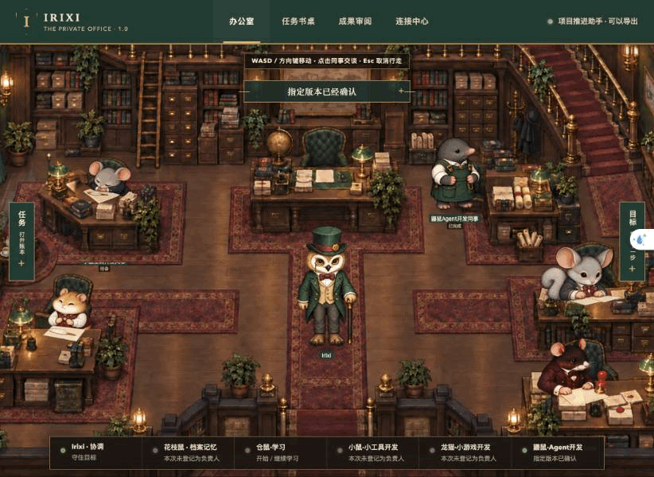

# iRIXI Personal Agent

### Talk through an idea. Build a real project. Pick it up next time.

A desktop personal AI agent with a conversation workbench, project files, real tools, and a living Victorian office.

**[简体中文](README.zh-CN.md) · [Get started](docs/getting-started.md) · [Project examples](docs/showcase.md) · [October 27 update](STAGE_STATUS.md) · [Contribute](CONTRIBUTING.md)**



*Office idle/rest recording. The current workbench adds project conversations, messages, model selection, and expandable work activity alongside this office.*

iRIXI helps you discuss, create, modify, and continue your own local projects. Start with a conversation. When you ask it to begin, the agent works on real files, runs checks, and gives you a usable result. A project can have several conversations that share its files and can look up relevant history.

The current workbench uses **OmO as its sole execution harness**. DZ supplies the internal rules for goals, plans, changes, checks, and continuity. The office, map, and animal colleagues are ways into your work; they do not restrict which projects you can tackle.

## What you can do

| Your workflow | What iRIXI provides |
| --- | --- |
| Think before you build | Discuss an idea without changing files. An explicit instruction starts work. |
| Work in your own folder | Choose an existing folder or a new project location. One project can contain multiple conversations. |
| Make and revise real deliverables | Read and search files, create and edit code, run commands, inspect results, and continue a change. |
| Explore another direction | Edit a message into a revision branch, or branch from a completed turn. Git projects can also use a separate worktree. |
| Bring context with you | Quote a message, attach material, or reference another conversation with its source preserved. |
| Choose the model for the next turn | Select an available model and supported reasoning level in the composer. Running and historical turns retain their selections. |
| See actual progress | Expand tool activity and real read-only sub-agent tasks, including their status and returned results. |
| Stop and return later | Save messages, project relationships, progress, and outcomes. Reopening does not silently restart model work. |

Project and conversation menus include rename, pin, unread state, sections, project assignment, new windows, archive, and restore. Text size and connection settings remain available from the office.

## A conversation-first workflow

```text
Discuss an idea → Ask it to begin → Choose a folder when needed
       → Build and check → Open the result → Request a change
       → Stop, reopen, or continue in another project conversation
```

There is no mandatory project setup form or repeated plan-approval ladder for ordinary work. The agent asks when a material detail or new permission is actually needed.

## Built and exercised on real local projects

The October 27 workbench delivery completed engineering, system acceptance, independent checks, and installation checks on the maintainer's Mac. Its local acceptance covered 23 required outcomes, including project organization, conversation branching, model selection, real tool activity, sub-agents, recovery, and existing-data preservation.

Two representative models completed project creation or modification, checks, and actual use of the resulting tools. Examples included a command-line expense calculator and an existing focus-recording web app that was extended and used after the change. Cross-conversation references and branch-material handling were also exercised.

This is a **source preview**. The maintainer's installed app and the public source have different distribution requirements; fresh-machine setup still needs the local runtimes described below. [Current scope →](STAGE_STATUS.md)

## Run from source

The current native shell is for macOS. Source development requires Node.js 24+, npm, Git, and a desktop browser. Real agent work additionally requires a locally prepared OmO runtime and an existing authenticated Desktop Codex CLI.

```bash
git clone https://github.com/Irixil/irixi-office-agent.git
cd irixi-office-agent
npm ci
node scripts/start-personal-agent-p0.mjs
```

Open [localhost:58312](http://127.0.0.1:58312/?backend=openoffice&view=office). This starts the conversation workbench and stores data in the current user's application-support directory. It does not install OmO or authenticate a model account. Model work begins only after a user submission.

For the runtime layout, isolated development directories, functional browser checks, and the macOS wrapper, see [getting started](docs/getting-started.md). This repository update provides source; it does not publish a signed installer.

## How it fits together

- **Workbench:** JavaScript and a local Node.js service, with projects, conversations, messages, references, branches, and persistent outcomes.
- **Execution:** [OmO](https://github.com/code-yeongyu/oh-my-openagent) native RPC, host-enforced tool scopes, and a replaceable model/CLI bridge. The current integration targets OmO 5.1.40.
- **Continuity:** bundled DZ rules mapped to product task storage. The developer repository's `.dz/` ledger is separate from user conversations.
- **Office:** Phaser and EasyStar.js, iRIXI artwork, and scene/grid adaptations credited to [agent-office](https://github.com/harishkotra/agent-office).
- **Desktop shell:** a macOS Swift/WebKit application with folder selection, local deep links, multiple windows, and restart handling.

See the [architecture](docs/architecture/goal-first-agent.md) and [third-party notices](THIRD_PARTY_NOTICES.md). Earlier OpenOffice integration and example projects remain as historical/compatibility source.

## Data, accounts, and current scope

Project files stay at the location you choose. Conversation state and runtime records are saved locally. Model requests and selected context are sent through your configured model connection; local storage does not mean offline inference. Account access and provider usage remain yours.

The source excludes credentials, private conversations and materials, runtime records, approvals, and installed binaries. Public web sharing, broader provider connections, extended automatic personal memory, and complex parallel merging are later work.

## Join the project

Try a concrete personal-project workflow, report a reproducible problem, or improve the setup guide. [Contribution guide](CONTRIBUTING.md) · [Report an issue](https://github.com/Irixil/irixi-office-agent/issues/new?template=bug_report.yml) · [Suggest a use case](https://github.com/Irixil/irixi-office-agent/issues/new?template=feature_request.yml)

Original iRIXI code and artwork do not yet have a repository-wide license. Upstream components retain their own notices and licenses. See [THIRD_PARTY_NOTICES.md](THIRD_PARTY_NOTICES.md).
