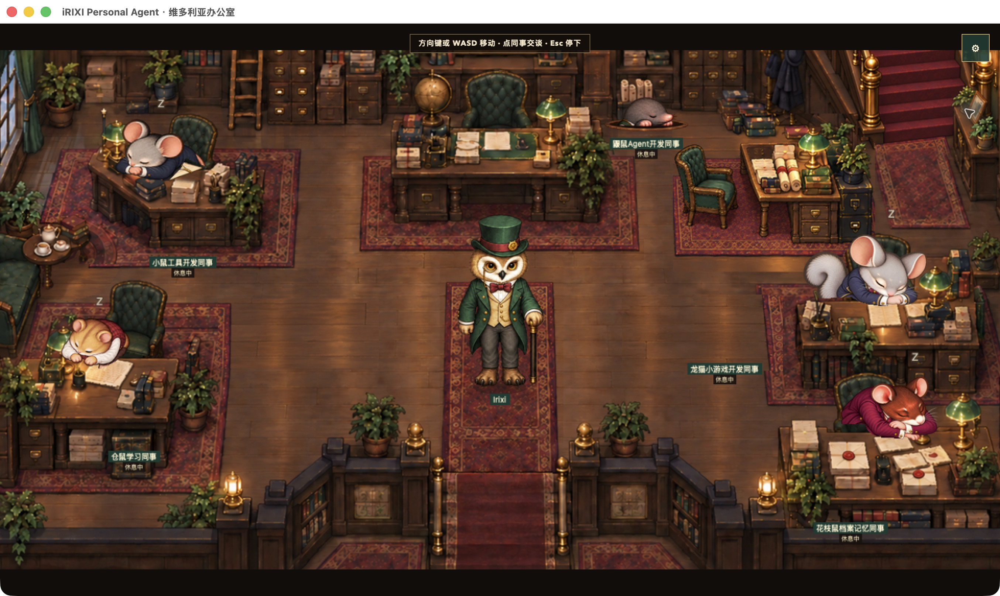

# iRIXI Personal Agent

### 先聊清想法，再做出项目，下次回来接着做。

面向本地项目、编程与学习的桌面个人 AI Agent。保留项目对话与记忆，使用真实文件和工具，也有一间会生活的维多利亚办公室。

**[English](README.md) · [开始使用](docs/getting-started.md) · [项目实例](docs/showcase.md) · [最新版本](https://github.com/Irixil/irixi-office-agent/releases/tag/preview-2026-10-31) · [参与贡献](CONTRIBUTING.md)**



*2026 年 10 月 30 日 macOS 应用实景。点击同事打开对话。办公室动画在本机运行，不调用模型。*

iRIXI 帮你讨论想法、制作和修改真实项目。明确开工后，Agent 读改文件、运行检查并交付可使用的成果。下次回来，带着原文件、对话与项目决定接着做。

## 你可以用它做什么

| 你要做的事 | 对应能力 |
| --- | --- |
| 先把想法聊清楚 | 先讨论；明确开工后才修改文件。 |
| 在自己的目录里做项目 | 一个项目组织多段对话，共用实际文件，按需查阅相关历史。 |
| 做出并修改真实成果 | 读写代码、运行命令、检查结果、打开成果，再提出修改。 |
| 带着上下文继续 | 引用消息、添加材料、引用其他对话，或通过分支尝试新方向。适用 Git 项目可使用独立工作目录。 |
| 记住有用的信息 | 区分个人偏好、项目决定与临时要求，支持修改、停用、恢复和删除记忆。 |
| 让助手分担工作 | 查看真实只读助手与独立副本中的受限写入，组合检查后再采用成果。 |
| 选择下一轮连接 | 输入框内选择可用模型和思考强度，使用已有 CLI 连接或官方 OpenAI API Key 连接。 |
| 停下来，下次再做 | 保存进度、历史和成果，重开不会自行启动模型工作。 |

项目与对话支持改名、置顶、未读、分区、归档、恢复及新窗口。消息支持复制、引用、编辑修订和分支。底部对话可展开为长内容工作区，草稿与历史保持一致。

## 五位同事，共用一个工作台

仓鼠偏学习，小鼠偏工具开发，龙猫偏小游戏，鼹鼠偏 Agent，花枝鼠偏档案与记忆。专长是入口，每位同事都能处理通用项目。学习入口可使用本机安装的学习 Skill；小游戏入口可通过适配连接，调用另行准备的 Noobi。

人物状态对应实际工作。行走、待机、趴桌睡与唤醒都是本机动画，支持减少动态设置。

## 从对话到能用的成果

```text
讨论 → 明确开工 → 必要时选择文件夹
     → 制作并检查 → 打开成果 → 提出修改
     → 停止、重开，或换一段项目对话继续
```

近期实例是在原有专注记录网页中增加记录编辑。产品通过正常 OmO 与官方 OpenAI API Key 连接完成新增、编辑、取消、删除和每日合计；刷新、退出原生应用再重开后记录保持。产品底座修补与外部核查另行完成，不归为 Agent 独立开发成果。[查看项目实例 →](docs/showcase.md)

普通工作无需填写固定项目设置表单，也无需逐级批准固定格式计划。关键问题和新增权限在实际对话中处理。

## 从源码启动

**面向开发者的源码预览版。** 当前原生外壳面向 macOS。真实 Agent 工作需要提前准备 Node.js 24+、npm、Git、桌面浏览器、OmO 5.1.40 和已配置的 Codex CLI。本仓库不包含运行库或已签名安装器。

```bash
git clone https://github.com/Irixil/irixi-office-agent.git
cd irixi-office-agent
npm ci
npm start
```

打开 [localhost:58312](http://127.0.0.1:58312/?backend=openoffice&view=office)。启动界面不会自行开始模型工作。[完整安装、连接选项与隔离开发说明 →](docs/getting-started.md)

## 2026 年 10 月 31 日源码更新

- 持久项目对话、可编辑记忆、同事交接与受限并行助手。
- 官方 OpenAI API Key 文件连接，以及工具检查与中断恢复更新。
- 办公室坐姿、通行、趴桌睡和起身过渡更新。
- 同步 10 月 30 日本机交付源码，刷新中英文介绍与使用文档。

[版本说明](https://github.com/Irixil/irixi-office-agent/releases/tag/preview-2026-10-31) · [更新日志](CHANGELOG.md) · [当前范围](STAGE_STATUS.md)

## 执行与数据

OmO 是唯一执行框架。DZ 在产品内部组织目标、计划、变化、检查与续接，映射到产品存储。模型与 CLI 连接可以替换。开发仓库 `.dz/` 与用户任务存储分开。

项目文件保存在你选择的位置，对话与运行记录保存在本机。模型请求仍会通过配置的连接发送相关上下文，本地保存不等于离线推理。账户与费用由使用者自己的连接决定。

OpenAI Key 路线使用本机限制访问权限的**明文文件**，不自动回退旧账户，当前不调用 Noobi 工具。DeepSeek 接口准备已包含，真实连接验证按既定安排延期。公开源码不含凭据、私人对话与材料、运行记录或安装二进制。

[架构说明](docs/architecture/goal-first-agent.md) · [第三方说明](THIRD_PARTY_NOTICES.md)

## 一起改进 iRIXI

欢迎带着具体个人项目试用，可以[报告可复现问题](https://github.com/Irixil/irixi-office-agent/issues/new?template=bug_report.yml)、[提出场景](https://github.com/Irixil/irixi-office-agent/issues/new?template=feature_request.yml)，或改进[安装说明](docs/getting-started.md)。如果项目对你有用，欢迎点 Star，让更多人发现它。

iRIXI 原创代码与美术尚未指定全仓库统一许可证。上游署名与许可见[第三方说明](THIRD_PARTY_NOTICES.md)。
